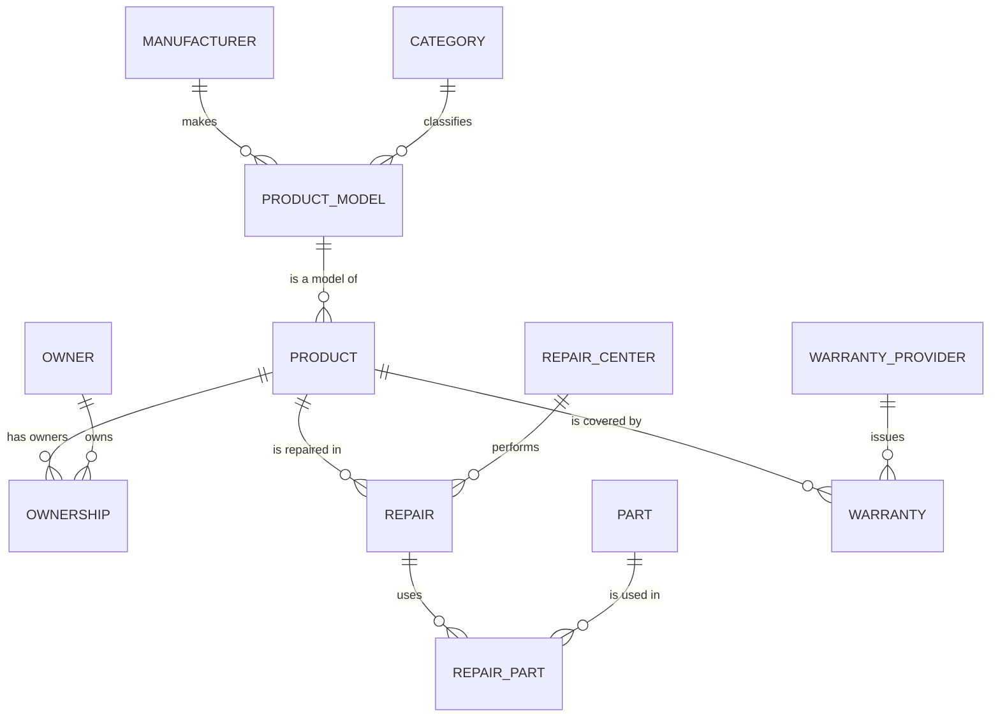

# RepairPass: A Digital Passport for Second-Hand Devices

RepairPass is a database-driven web application that keeps the complete life history of an electronic device in one place. Enter a device's serial number or IMEI and RepairPass shows who has owned it, every repair it has had (with the parts replaced and what they cost), and whether its warranty is still valid.

Built as a DBMS course project with **Flask**, **MySQL** and plain HTML/CSS.

---

## Table of contents

1. [The problem](#the-problem)
2. [Features](#features)
3. [Tech stack](#tech-stack)
4. [Database design](#database-design)
5. [Design decisions](#design-decisions)
6. [How it works](#how-it-works)
7. [Project structure](#project-structure)
8. [Getting started](#getting-started)
9. [Using the application](#using-the-application)
10. [Sample data](#sample-data)
11. [Troubleshooting](#troubleshooting)
12. [Limitations and future scope](#limitations-and-future-scope)

---

## The problem

When someone buys a used phone or laptop, they usually cannot answer basic questions:

- Who owned it before, and how many owners has it had?
- Has it been repaired, and which parts were replaced?
- Was the repair done by an authorized service center or an unknown shop?
- Is there still a valid warranty?

Sellers can hide a repair, and the records are scattered across shops and manufacturers. RepairPass solves this by storing the whole history in a normalized relational database and presenting it as one readable "passport" per device.

---

## Features

| Feature | Description |
| --- | --- |
| **Device search** | Look up any device by serial number or IMEI and open its passport |
| **Device list** | Home page lists every registered device with its manufacturer, category and current owner |
| **Passport page** | Device details, a combined timeline, ownership chain, repairs and warranties on one page |
| **Ownership chain** | Full list of past and present owners with exact start and end dates |
| **Ownership transfer** | Sell a device to a new or existing person; the previous owner's record is closed on the same day the new one starts, so the chain never has gaps |
| **Repair logging** | Record a repair with the repair center, issue, work done, labour cost and up to three parts (quantity and cost each) |
| **Automatic repair total** | Total cost = labour + sum of (part cost x quantity), calculated by the query |
| **Authorized-center flag** | Each repair shows whether the shop is an authorized or unauthorized center |
| **Warranty tracking** | Add warranties; status is shown as **Active** or **Expired**, calculated from today's date |
| **Flat report** | A collapsible table on each passport that reads the `vw_DevicePassport` database view |
| **Table browser** | View the contents of all 12 tables and add rows to the lookup tables (manufacturers, categories, models, owners, repair centers, parts, warranty providers) |
| **Validation** | Friendly error messages for duplicate serial numbers, invalid dates, bad numbers and database constraint failures |

---

## Tech stack

| Layer | Technology | Purpose |
| --- | --- | --- |
| Database | MySQL | Stores all data and enforces keys and constraints |
| Database driver | PyMySQL | Lets Python run SQL against MySQL |
| Backend | Python and Flask | Routes, validation, SQL queries and transactions |
| Templates | Jinja2 | Builds HTML pages from query results |
| Frontend | HTML and CSS | Page layout and styling (no JavaScript framework) |

Flask was chosen over an ORM on purpose: every SQL statement is written by hand and visible in `app.py`, which keeps the database work clear and easy to explain.

---

## Database design

The database is called `RepairPassDB` and has **12 tables** in four modules, plus one reporting **view**.

### Entity-relationship diagram



### Tables

| Module | Table | Primary key | What it stores |
| --- | --- | --- | --- |
| Device and model | `MANUFACTURER` | `manufacturer_id` | Companies such as Apple and Dell, with country and support website |
| Device and model | `CATEGORY` | `category_id` | Smartphone, Laptop and so on |
| Device and model | `PRODUCT_MODEL` | `model_id` | A model such as "iPhone 14 Pro"; links to manufacturer and category |
| Device and model | `PRODUCT` | `product_id` | One physical device, identified by a unique `serial_number` |
| Owner and ownership | `OWNER` | `owner_id` | A person's name and contact details |
| Owner and ownership | `OWNERSHIP` | `ownership_id` | Which owner had which device, from `start_date` to `end_date` |
| Repair logging | `REPAIR_CENTER` | `center_id` | Shop name, city, contact and an authorized flag (Yes/No) |
| Repair logging | `REPAIR` | `repair_id` | One repair event on a device at a center |
| Repair logging | `PART` | `part_id` | A replaceable part such as a battery |
| Repair logging | `REPAIR_PART` | (`repair_id`, `part_id`) | Parts used in a repair, with quantity and cost |
| Warranty tracking | `WARRANTY_PROVIDER` | `provider_id` | AppleCare+, Dell ProSupport and so on |
| Warranty tracking | `WARRANTY` | `warranty_id` | A warranty period on a device from a provider |
| Reporting | `vw_DevicePassport` (view) | n/a | A flat joined report of a device with owner, repairs, parts and warranty |

### Relationships

- One manufacturer has many models, and one category has many models (1:N each).
- One model has many physical products (1:N).
- Products and owners are **many-to-many**, resolved by the `OWNERSHIP` table, which also stores the dates.
- Repairs and parts are **many-to-many**, resolved by the `REPAIR_PART` table, which also stores quantity and cost.
- One product has many repairs and many warranties (1:N each).

### Constraints used

- `PRIMARY KEY` on every table, with a composite key on `REPAIR_PART`.
- `FOREIGN KEY ... ON DELETE CASCADE` so deleting a parent removes its dependent rows.
- `UNIQUE` on `PRODUCT.serial_number`, so no two devices share a serial.
- `NOT NULL` on mandatory fields.
- `CHECK` constraints: ownership `end_date >= start_date`, warranty `end_date >= start_date`, `quantity > 0`, `is_authorized IN ('Yes','No')`, `release_year >= 2000`.
- `DEFAULT 0.00` on `labour_cost`.

### Normalization

The schema is in **Third Normal Form**: every column holds a single value, every non-key column depends on the whole key, and there are no transitive dependencies. For example, manufacturer details are stored once in `MANUFACTURER` instead of being repeated in every device row.

---

## Design decisions

- **Derived values are not stored.** Warranty status and repair total cost are calculated in the query each time, so they can never be out of date or disagree with the underlying rows.
- **History is never overwritten.** The current owner is simply the `OWNERSHIP` row where `end_date IS NULL`. A transfer closes that row and adds a new one, so the full chain is preserved.
- **Gap-free ownership.** On transfer, the old owner's `end_date` and the new owner's `start_date` are set to the same date.
- **Transactions for multi-step changes.** Registering a device, transferring ownership and adding a repair with its parts each run as one transaction: they either fully succeed or are fully rolled back.
- **Row locking.** The transfer reads the current ownership row with `SELECT ... FOR UPDATE`, so two simultaneous transfers of the same device cannot both succeed.
- **No SQL injection.** Every query passes user input as parameters (`%s` placeholders), never by joining strings. Table names in the table browser come from a fixed whitelist.

---

## How it works

```
Browser  <-->  Flask (app.py)  <-->  PyMySQL  <-->  MySQL (RepairPassDB)
                   |
             Jinja2 templates
```

1. The browser requests a page, for example `/passport/F2LX3091DN`.
2. Flask runs the matching function in `app.py`.
3. That function runs SQL queries (joins, aggregates, a view) through PyMySQL.
4. The rows come back as dictionaries and are passed to a Jinja2 template.
5. The template loops over the rows and returns finished HTML.

### Pages and routes

| URL | Method | What it does |
| --- | --- | --- |
| `/` | GET | Search box and list of all devices |
| `/search` | GET | Redirects to the passport for the entered serial number |
| `/passport/<serial>` | GET | Full device passport |
| `/device/new` | GET, POST | Register a new device and its first owner |
| `/device/<pid>/transfer` | POST | Transfer ownership of a device |
| `/device/<pid>/repair` | POST | Add a repair and its parts |
| `/device/<pid>/warranty` | POST | Add a warranty |
| `/tables` | GET | Row counts for all 12 tables |
| `/tables/<name>` | GET, POST | View a table; add a row to lookup tables |

---

## Project structure

```
RepairPass/
├── app.py              Flask routes, SQL queries and transaction logic
├── config.py           MySQL connection settings (reads environment variables)
├── schema.sql          Creates the database, 12 tables, sample data and the view
├── setup_db.py         One-time script that builds the database from schema.sql
├── requirements.txt    Python dependencies (Flask, PyMySQL)
├── README.md           This file
└── templates/
    ├── base.html       Shared layout, navigation and styles
    ├── index.html      Search page and device list
    ├── passport.html   Device passport and its forms
    ├── new_device.html Register-device form
    └── tables.html     Table browser
```

---

## Getting started

### Prerequisites

- **Python 3.9 or newer**
- **MySQL Server** (and optionally MySQL Workbench), with the server running
- Your MySQL username and password (the default user is `root`)

### 1. Get the code

```
git clone https://github.com/ydv-himanshu/RepairPass.git
cd RepairPass
```

You can also download the repository as a ZIP from GitHub, extract it, and open a terminal inside the extracted folder.

### 2. Install the dependencies

```
pip install -r requirements.txt
```

This must be run from inside the project folder, where `requirements.txt` lives.

### 3. Set your database password

`config.py` reads its settings from environment variables, and the password in the file is only a placeholder. The recommended way is to set it in the terminal each time:

**Windows (PowerShell)**
```
$env:DB_PASSWORD="your_mysql_password"
```

**Windows (Command Prompt)**
```
set DB_PASSWORD=your_mysql_password
```

**Mac / Linux**
```
export DB_PASSWORD=your_mysql_password
```

Other settings can be changed the same way: `DB_HOST` (default `localhost`), `DB_PORT` (default `3306`), `DB_USER` (default `root`) and `DB_NAME` (default `RepairPassDB`).

> Do not commit your real password to GitHub. Keep the placeholder in `config.py` and use the environment variable, or do not commit that file.

### 4. Create the database

```
python setup_db.py
```

This runs `schema.sql`, which creates the database, all 12 tables, the sample data and the `vw_DevicePassport` view. You should see `Database RepairPassDB created with sample data.`

To wipe the database and rebuild it from scratch, run:

```
python setup_db.py --reset
```

You can also skip this step and run `schema.sql` yourself in MySQL Workbench (File, Open SQL Script, then run it).

### 5. Run the application

```
python app.py
```

Leave this terminal open while you use the site. Press `Ctrl+C` to stop it.

### 6. Open it in your browser

Go to **http://127.0.0.1:5000**. This address only works on your own computer while `python app.py` is running.

---

## Using the application

**Look up a device.** Type a serial number such as `F2LX3091DN` in the search box, or click **Open passport** on any device in the list.

**Read a passport.** It shows the device details, a timeline of ownership, repair and warranty events, the ownership chain, each repair with its parts and total cost, and the warranty history with an Active or Expired badge. A collapsible **Full report** section shows the same data as a flat table from the database view.

**Register a device.** Click **Register device** in the menu, enter the serial number, choose a model, the purchase date and the first owner (an existing person or a new one). If the model you need is missing, add it first under **Tables, PRODUCT_MODEL**.

**Transfer ownership.** Open a device, expand **Transfer ownership (device sold)**, pick the new owner and the date of sale. The previous owner's end date is set to that same date.

**Add a repair.** Expand **Add a repair**, choose the repair center, date, issue, work performed and labour cost, and select up to three parts with quantity and cost per unit. The total is calculated automatically.

**Add a warranty.** Expand **Add a warranty**, choose the provider and the start and end dates.

**Add lookup data.** On the **Tables** page, open a lookup table (for example `REPAIR_CENTER` or `PART`) and use the form below the data to add a row. IDs are generated automatically.

---

## Sample data

`schema.sql` loads two devices so you can see the app working straight away.

| Serial | Device | What it demonstrates |
| --- | --- | --- |
| `F2LX3091DN` | Apple iPhone 14 Pro | Two owners (Rahul Sharma, then Priya Verma, handed over on 2025-08-01), one repair at an unauthorized center (OLED display 150 + battery 50 + labour 50 = **250**), and an **Expired** AppleCare+ warranty |
| `DLX8820391` | Dell XPS 15 | A device with no owner, repair or warranty yet, so you can try the forms yourself: transfer ownership to give it an owner, then add a repair and a warranty |

To see how the app handles errors, try registering a device with a serial number that already exists, or add a warranty whose end date is before its start date.

---

## Troubleshooting

| Problem | Likely cause and fix |
| --- | --- |
| `Could not open requirements file: 'requirements.txt'` | The terminal is not in the project folder. Use `cd` to move into it |
| `ModuleNotFoundError: No module named 'flask'` or `'pymysql'` | Run `pip install -r requirements.txt` |
| `Can't connect to MySQL server` | The MySQL service is not running. Start it (on Windows, open Services and start MySQL) |
| `Access denied for user 'root'` | The password is wrong. Set `DB_PASSWORD` to your real MySQL password |
| `Unknown database 'RepairPassDB'` or `Table ... doesn't exist` | The database has not been created. Run `python setup_db.py` |
| `Database ... already has N tables` | It already exists. Use `python setup_db.py --reset` only if you want to wipe it and start over |
| The browser cannot reach the site | Make sure `python app.py` is still running, and use `http://127.0.0.1:5000` (not `https`) |
| Port 5000 is already in use | Close the other terminal running the app, then start it again |

---

## Limitations and future scope

**Current limitations**

- There is no login or user roles, so anyone with access can add records and nothing is verified.
- The repair form accepts up to three parts at a time (the database itself has no such limit).
- The "only one current owner per device" rule is enforced by the application and row locking, because MySQL has no partial unique index.
- It runs on Flask's development server and is meant for demonstration, not production.

**Future scope**

- User accounts with roles: owner, repair center, admin and read-only buyer.
- Repair centers that sign in and log their own repairs, so history is trustworthy.
- A QR code on each device that opens its passport.
- Invoice and photo uploads attached to repairs and warranties.
- Warranty expiry reminders by email or SMS.
- A stolen or blacklisted flag checked at registration.
- A trust score based on repair history and number of owners.
- Production deployment with indexes for larger data.

---

## Author

Created by [ydv-himanshu](https://github.com/ydv-himanshu) as a DBMS course project.
